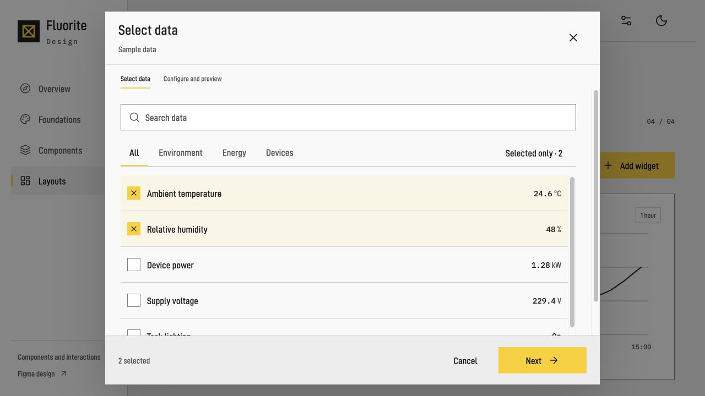

# Components and examples

## Pages

| Figma Page | Web | Content |
| --- | --- | --- |
| 00 · Foundations | `#foundations` | Themes, typography, dimensions and icons |
| 01 · Components | `#components` | Controls, states and feedback |
| 02 · Page examples | `#overview` / `#layouts` | Overview, dashboard, selection, configuration and display preferences |

Figma provides static designs and representative prototypes; Web provides full interaction. Sample data and action results are simulated. Hosts supply business behavior and persistence.

## Coverage

| Category | Components |
| --- | --- |
| Actions | Buttons, icon buttons |
| Inputs | Text, search, multiline, number, date, upload |
| Selection | Checkbox / mixed state, radio, switch, select, combobox, tags, value / range slider |
| Navigation | Tabs, navigation items, breadcrumbs, steps, menus, accordion, tree, pagination |
| Data | Table, numeric / enum / unavailable cards, entity list, history chart |
| Feedback | Status, notice, notification, progress, skeleton, empty state, error |
| Overlays | Tooltip, popover, dialog, drawer |

Functional references: [Radix](https://www.radix-ui.com/primitives/docs/overview/introduction), [Ant Design](https://ant.design/components/overview/), [React Aria](https://react-aria.adobe.com/ComboBox). Visual rules: [DESIGN.md](DESIGN.md).

## Flows

- Create: select data → configure and preview → add.
- Edit: open existing configuration directly; confirm deletion within editing.
- Search, filters and back preserve the draft and order; cancel discards the draft.
- Display preferences apply immediately; exit with “Close”.

