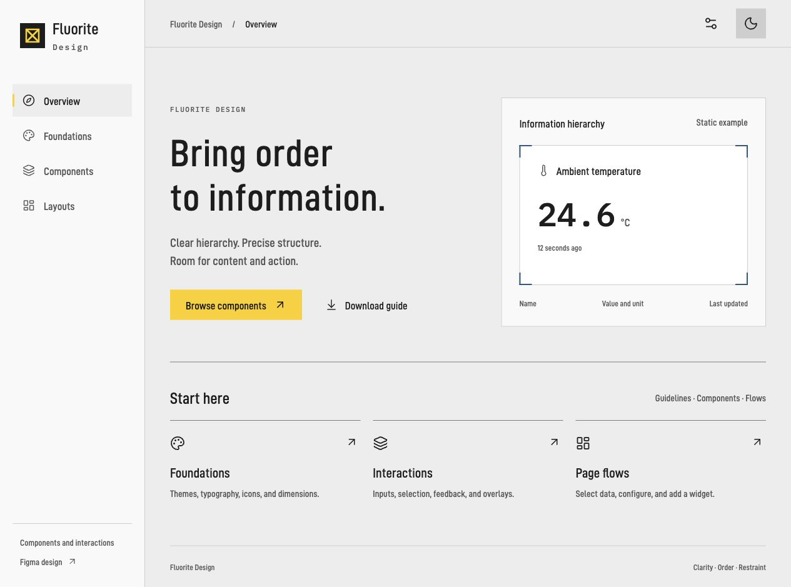
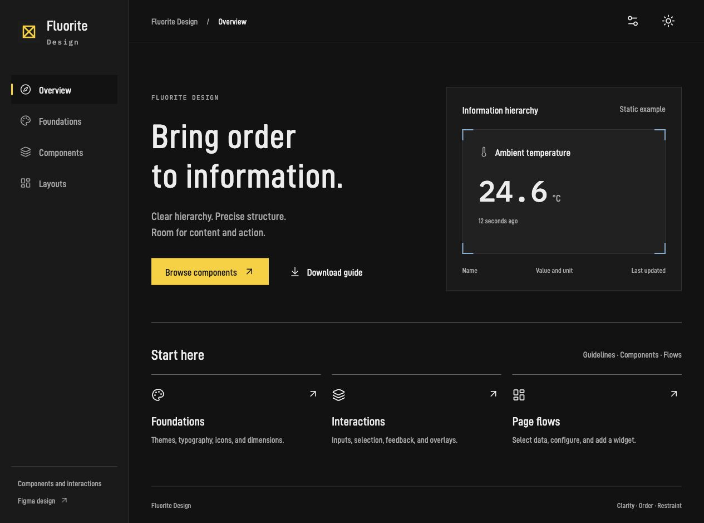
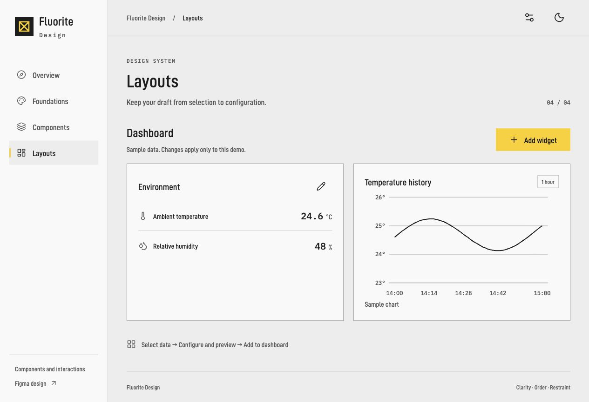
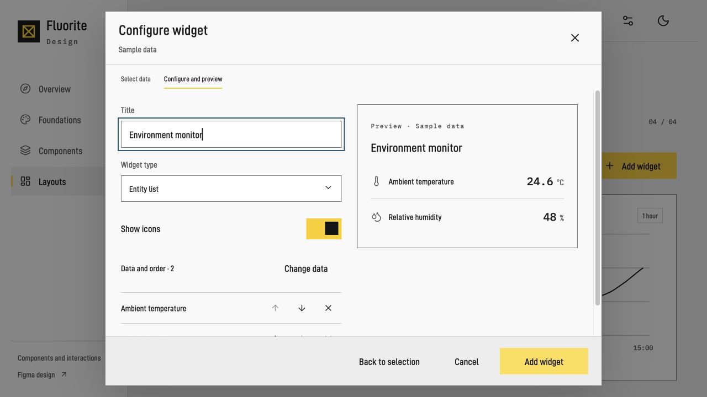

# Fluorite Design

Restrained industrial UI/UX guidelines for agents, shared as a Git submodule.

[Web examples](https://fluorite-design.sassylark8.chatgpt.site/) · [Figma](https://www.figma.com/design/zRND6JG1dfnxrT4djl7qY8/Fluorite-Design)

## Preview

| Light | Dark |
| --- | --- |
|  |  |

| Dashboard | Component configuration |
| --- | --- |
|  |  |

## Documentation

| Entry | Purpose |
| --- | --- |
| [AGENTS.md](AGENTS.md) / [CLAUDE.md](CLAUDE.md) | Agent instructions |
| [DESIGN.md](DESIGN.md) | Design rules |
| [REVIEW.md](REVIEW.md) | Delivery checklist |
| [COMPONENTS.md](COMPONENTS.md) | Components and examples |
| [web/README.md](web/README.md) | Development and maintenance |

## Integration

```sh
git submodule add https://github.com/skyboooox/fluorite-design.git docs/design/fluorite-design
git submodule update --init --recursive
```

Reference from the host AGENTS.md:

```text
Follow docs/design/fluorite-design/AGENTS.md for UI/UX work.
```

Reference from the host CLAUDE.md:

```text
@docs/design/fluorite-design/AGENTS.md
```

Include the root guidelines in the submodule and pin a reviewed commit. Commit the entry references, `.gitmodules` and submodule pointer. Record platform, input, viewport and rule adaptations in the host DESIGN.md.
